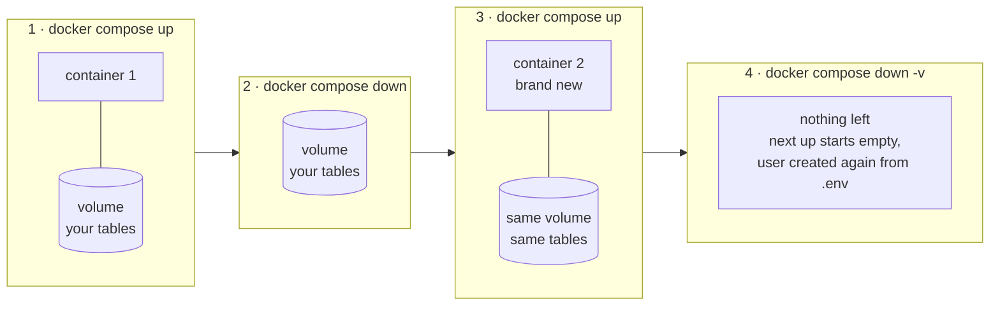

# Database

We use a PostgreSQL database with the PostGIS extension. It runs in its own Docker container, which is started by Docker Compose, and keeps its data in a Docker volume so the data survives a restart.

## Why it exists

Every module needs data that lasts longer than a single request: users, flats, listings, reviews, saved searches. Keeping it in the app's memory would lose all data every time the app restarts. One shared database gives everyone the same data, and we chose PostGIS because it lets us store a flat's location and ask how far it is from a faculty.

Running it in a container means nobody installs PostgreSQL by hand. Everyone gets the same version with the same settings from one command, `docker compose up`.

## How it works here

Three separate things make up "the database", and it helps to keep them apart:

- **The image** (`postgis/postgis` in `docker-compose.yml`) is the recipe: PostgreSQL plus PostGIS, ready to install. It's downloaded once and never changes.
- **The container** (the `postgis` service) is the running database program, made from the image, the part that makes the database "alive" on your machine. It can be stopped, deleted and recreated at any time.
- **The volume** (`data`, which Docker names `osijek-housing_data`) is where the actual data is stored, on your disk, managed by Docker. It's attached to the container at `/var/lib/postgresql`, the folder where PostgreSQL writes its files.

Because the data lives in the volume and not in the container, `docker compose down` deletes the container but keeps your data. The next `docker compose up` creates a fresh container and attaches the same volume. Only `docker compose down -v` deletes the volume, and with it all data.

Think of a game console and its memory card: you can replace the console as often as you like, and your saves are still there. The container is the console, the volume is the memory card.

**How things reach it.** The database listens on port 5432. What address to use depends on where the code runs:

- The **app container** reaches it by the service name, `postgis`. Compose puts all services on one private network where each service name works as an address. That's why `docker-compose.yml` sets `POSTGRES_HOST=postgis` for the app.
- **Code on your laptop**, outside Docker (a script, a database viewer), reaches it at `localhost:5432`. That works because `docker-compose.yml` publishes port 5432 from the container to your machine. `app/core/database.py` uses `localhost` when `POSTGRES_HOST` isn't set.

**Login.** The username and password come from your `.env` file, which stays out of Git. On the first start with an empty volume (the very first time, or after `docker compose down -v`), the image creates that user and a database with the same name. After that, the volume already holds a database, so changing `.env` doesn't change the existing login.

**Startup order.** Compose checks the database's health every 2 seconds and starts the app only once the database accepts connections. The app then runs the Alembic migrations, which create or update the tables, and only after that starts serving requests.

## Connects to

- [ADR 002](../adr/002-why-this-stack.md): why PostgreSQL, PostGIS and Docker Compose.
- [ADR 003](../adr/003-data-model-v1.md): which tables live in this database.
- `app/core/database.py`: the one place that builds the connection; everything else asks it for a session.
- [Migrations](migrations.md): the only way tables are created or changed.

## Common confusion

- **"I deleted the container. Is my data gone?"** No. The data is in the volume. Only `docker compose down -v` (or deleting the volume) removes it.
- **"I changed the password in `.env`, and now the app can't log in."** The user was created on the first start and is stored in the volume. Either change `.env` back, or delete the volume with `docker compose down -v` and start again (this deletes all local data).
- **"Why `postgis` in one place and `localhost` in another?"** Same database, different address depending on where the code runs: `postgis` inside the Compose network, `localhost` from your laptop.
- **"Is my local data the same as everyone else's?"** No. Each person has their own container and volume on their own laptop. Nothing is shared between laptops.
