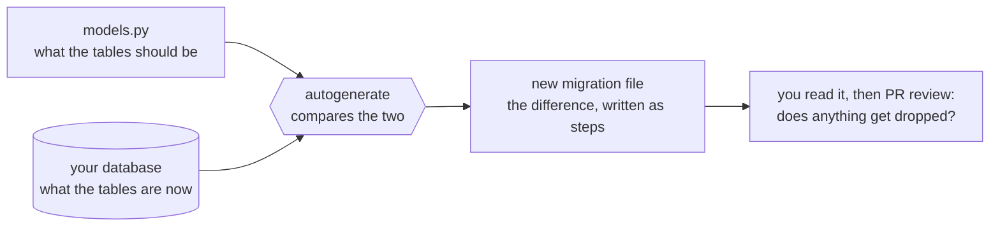

# Migrations

A migration is a small file that describes one change to the database's structure, such as "create these tables" or "add a column to listings". We use Alembic to write migrations and apply them. Together they form a history of how our database got its current shape, kept in Git next to the code.

## Why it exists

Our models in `app/core/models.py` describe what the tables _should_ look like. But the database on every laptop, and later on the server, already has tables with data in them. Something has to change those existing databases to match the models, without losing the data, and in the same way on every machine.

Without migrations, everyone would change their tables by hand. One person would forget a step, another would do it differently, and the server would be forgotten. Soon each database would have a slightly different shape, and code that works on one laptop would break on another. The quick fix, deleting the database and recreating it from the models, works locally, but on the server it would delete all real data.

Migrations solve this the way Git solves it for code: changes are written down once, in order, and every database replays the ones it hasn't seen yet.

| Git | Alembic |
| --- | --- |
| The files you change | `models.py`: what the tables should look like |
| A commit | A migration file: one change, with a link to the one before |
| The commit history | `alembic/versions/`: the chain of migrations |
| Where your checkout is (`HEAD`) | `alembic_version`: where this database is in the chain |
| `git pull` brings your copy up to date | `alembic upgrade head` brings this database up to date |
| Never rewrite pushed history | Never edit a merged migration |

## How it works here

Three pieces work together:

- **The models** (`app/core/models.py`): the shape we want the tables to have, written in Python.
- **The migration files** (`alembic/versions/`): the steps that get a database from one shape to the next. Each file has an `upgrade` part (make the change) and a `downgrade` part (undo it), and names the migration that came before it. That link is what puts the files in order, like a chain.
- **The `alembic_version` table**, inside each database: a single row recording which migration this database has reached. It's how a database "remembers" where it is in the chain.

**Applying migrations.** Every time the app container starts, it runs `alembic upgrade head` before serving requests. Alembic reads `alembic_version`, finds the newest migration file ("head"), and runs every step in between, in order. If the database is already up to date, it does nothing. So when you pull someone else's migration and restart, your database catches up on its own.

Each database has its own bookmark in the same chain. Say Bob's laptop is at step 1, the server at step 2 and yours at step 3, the head. On their next start, Bob's database runs steps 2 and 3, the server's runs step 3, and yours runs nothing. All three end at the same bookmark, with the same tables, but each keeps its own rows. This is also why editing a merged migration fails: if you change step 2 now, the server and your laptop are already past it and will never run it again.

**Making a new migration.** You change the models, then ask Alembic to _autogenerate_ a migration. It compares the models with your current database and writes a draft file with the differences. The draft is a suggestion, not a guarantee. Alembic can't tell a renamed column from a deleted one plus a new one, and if you rename a column it will drop the column, and the data in it, unless you fix the file. That's why every migration is read and reviewed by a person before it's merged.



Autogenerate compares against *your* database, so it must be up to date first. If it's behind the newest migration file, Alembic refuses with "Target database is not up to date". Restart the app (which runs `alembic upgrade head`), then generate.

**Structure, not rows.** A migration changes the tables, not the data you put in them. Adding a column keeps every existing row; the rows just get the new column, empty or with a default value.

**Our setup.** `alembic/env.py` connects Alembic to our project. It takes the database address from `app/core/database.py` and the wanted shape from the models, and uses GeoAlchemy2's helpers so PostGIS columns (locations) are handled correctly. Our first migration, `7b306fa07c29_create_initial_tables.py`, creates all the tables from ADR 003 at once.

## Connects to

- [Database](database.md): migrations change the structure of that database; the volume keeps the result between restarts.
- [ADR 002](../adr/002-why-this-stack.md): why Alembic, the standard partner of SQLAlchemy.
- [ADR 003](../adr/003-data-model-v1.md): the tables the first migration creates. From now on, the models and migrations are the source of truth, not the DBML file.
- Team rule 4: database changes only through migrations, reviewed by Marin, one open migration PR at a time. The next section explains why.

## Common confusion

- **"I changed `models.py`, but the table didn't change."** The models only describe the shape. The database changes when a migration runs. Generate a migration, check it, and restart the app.
- **"Two of us made a migration at the same time, and now Alembic complains about 'multiple heads'."** Both files say they come after the same migration, so the chain splits in two and Alembic doesn't know which one goes first. That's why we pull `main` before making a migration, say so in Discord, and keep only one migration PR open at a time.

  ```mermaid
  flowchart LR
      subgraph bad["Without pulling first: two heads, Alembic can't choose"]
          direction LR
          a1["1 · initial tables"] --> b1["2 · Bob's migration"]
          a1 --> y1["2 · your migration"]
      end
      subgraph good["After pulling main first: one chain"]
          direction LR
          a2["1 · initial tables"] --> b2["2 · Bob's migration"] --> y2["3 · your migration"]
      end
  ```
- **"Can I fix a mistake in a migration that's already merged?"** No, write a new one. Everyone who already ran the old file has it recorded in `alembic_version`, so Alembic will never run your edited version on their database. Their database and yours would quietly differ.
- **"Does a migration delete my data?"** Only if it drops a table or column. That's exactly what to look for when reading a generated migration.
