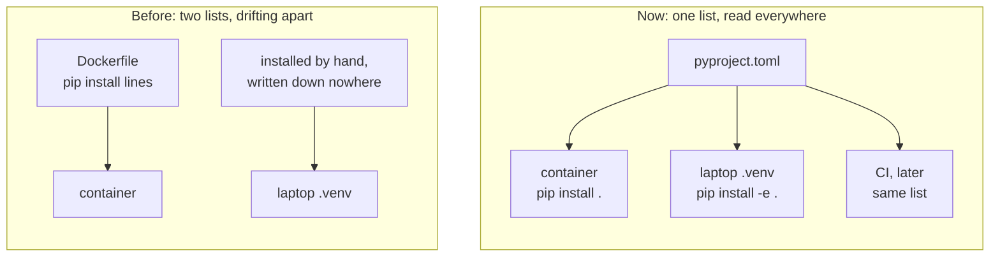

# pyproject.toml

Our app is built on other people's code, called libraries: FastAPI for the web server, SQLAlchemy for the database, pytest for tests, and so on. They don't come with Python, so every computer that runs the app has to install them first. `pyproject.toml` is the one list of what the app needs, and every place the app runs installs from it.

## Why it exists

The app runs in more than one place: in the Docker container, and in each teammate's `.venv` on their laptop. Later it also runs in CI on GitHub and on the server. All of them need the same libraries, at versions that work with our code.

Before, the only list was a set of `pip install` lines inside the `Dockerfile`. On laptops, people installed libraries by hand whenever something was missing, and nothing wrote that down. That went wrong in three ways:

- **Laptops drifted from Docker.** Marin's `.venv` never had jinja2 or python-multipart. Nobody noticed, because the app worked in Docker.
- **Teammates had to guess.** Setting up a laptop meant reading the Dockerfile and copying names by hand.
- **No versions.** Each install got whatever was newest that day, so two people could run different code without knowing it.

Think of the ingredient list on a recipe. Without it, every cook guesses, and every dish comes out a little different.

## How it works here

`pyproject.toml` sits in the project root. pip reads it and installs what it lists. The file itself never runs. It has four parts:

| Part                              | What it says                                                                                           | Ours                                                                                                 |
| --------------------------------- | ------------------------------------------------------------------------------------------------------ | ---------------------------------------------------------------------------------------------------- |
| `requires-python`                 | Which Python the app needs. pip refuses to install on an older one.                                    | 3.12 or newer, the same as the Dockerfile's base image                                               |
| `dependencies`                    | Libraries the app needs to **run**, each with a minimum version                                        | FastAPI, uvicorn, SQLAlchemy, Alembic, psycopg, python-dotenv, GeoAlchemy2, Jinja2, python-multipart |
| `[dependency-groups]` `dev`       | Tools only developers need. The server never installs them.                                            | pytest                                                                                               |
| `[tool.setuptools.packages.find]` | Which folder is our code. Without it, setuptools sees both `app/` and `alembic/` and refuses to guess. | `app`                                                                                                |

**Versions.** Each library has a minimum version (`>=`), set to the version we had installed when we wrote the list. Nobody gets an older version that our code might break on, and bug-fix updates still come in. Exact pins (`==`) would stop surprise updates, but someone would have to bump them by hand all the time.

**Only direct dependencies.** We list what our code uses directly, not what those libraries need in turn. FastAPI needs pydantic, for example, and pip installs it automatically. Libraries from Python itself (`os`, `datetime`, `logging`) are never listed, because pip doesn't install them.

**Two ways to install:**

- **On your laptop**, inside `.venv`: `pip install -e .` installs the libraries and the project itself. `-e` ("editable") means Python reads `app/` straight from your folder, so code changes take effect without reinstalling. Then `pip install --group dev` adds pytest. This needs pip 25.1 or newer.
- **In Docker**: the Dockerfile copies `pyproject.toml` into the image and runs `pip install .`. There's no `-e`, because the image never changes after it's built, and no dev group, because the container doesn't need pytest.

## Connects to

- [Database](database.md): SQLAlchemy, Alembic, psycopg and GeoAlchemy2 from this list are what our code uses to talk to it.
- [Migrations](migrations.md): Alembic is one of the dependencies, and the container runs it on every start.
- [ADR 002](../adr/002-why-this-stack.md): why we chose these libraries. This file only lists them.
- Team rule 5: `pyproject.toml` is a shared file. Anyone may change it in a PR, and Marin reviews it.

## Common confusion

- **"I installed a library with pip and it works for me, but it crashes for everyone else."** `pip install something` only changes your own `.venv`. Add the library to `pyproject.toml` in the same PR as the code that uses it, so everyone else gets it too.
- **"Someone changed `pyproject.toml`. Do I need to do anything?"** Yes. After pulling, run `pip install -e .` again on your laptop, and use `docker compose up --build` so Docker rebuilds the image with the new list. A plain `docker compose up` reuses the old image.
- **"Why isn't pytest in `dependencies`?"** That list is what the app needs to run, and the app never imports pytest. Putting it there would install a testing tool on the server for nothing.
- **"What is the `osijek_housing.egg-info/` folder?"** pip creates it on your laptop to record that the project is installed. It's generated, so `.gitignore` keeps it out of Git.
- **"pip says it doesn't know `--group`."** Your pip is older than 25.1. Upgrade it inside `.venv` first.
