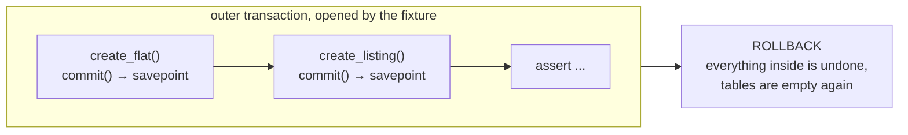
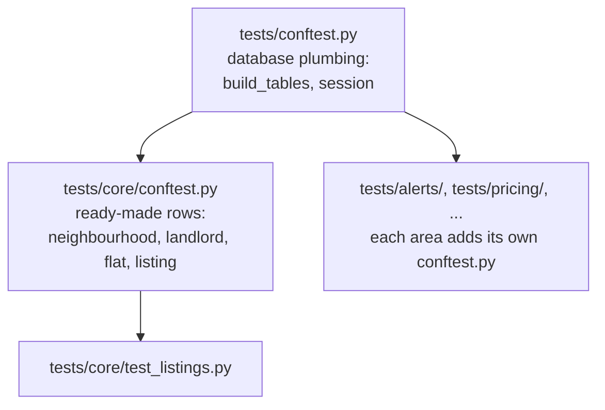

# Testing

We test with pytest. The tests run on your own computer and talk to a real PostgreSQL database, `osijek_test`, which lives in the same Docker container as your normal database but is completely separate from it. How to set it up and run the tests is in the README, under "Running tests".

## Why it exists

Every core function has rules: a price must be above zero, an archived flat can't get a new listing, the price filter includes its own limits. Core functions must work no matter what, regardless of the fact that you decided to add new row or modify existing one. Checking these by hand after every change takes long, and nobody does it every time. A test writes the check down once, and `pytest` repeats all of them in a few seconds.

The tests use a real database instead of fake objects, because most of what can go wrong is in the database: a constraint, a PostGIS column, a query that joins the wrong table, a migration that doesn't apply. A fake would pretend all of that works.

The test database is separate so that tests never see or change your own data. They can create and delete whatever they need, and your local data stays as it was.

## How it works here

**Choosing the database.** `tests/conftest.py` sets `POSTGRES_DB=osijek_test` as its very first line, before anything from `app` is imported. `app/core/database.py` builds the engine the moment it's imported, and reads `POSTGRES_DB` to decide which database to connect to. If the setting came later, the engine would already point at your normal database. `load_dotenv()` doesn't overwrite a setting that already exists, so the value in your `.env` doesn't win either.

**Building the tables.** The `build_tables` fixture runs `alembic upgrade head` once, at the start of the whole run. The tests never create tables from the models directly: they get exactly the tables our migrations produce. So a migration that's broken fails the tests too.

**Keeping every test clean.** Each test that asks for `session` gets a fresh one, and everything it saves is thrown away afterwards:

1. The fixture opens a connection and starts a transaction on it, the outer one.
2. The session is created inside that transaction with `join_transaction_mode="create_savepoint"`. When code calls `session.commit()`, it only commits up to a savepoint inside the outer transaction, so nothing is really saved.
3. The test runs. Core functions call `commit()` as usual and don't notice anything.
4. When the test ends, the fixture rolls back the outer transaction. Every row the test created disappears.

Benefit of this approach is that we can write and erase as much as we want, and at the end all test data is erased automatically. That's why the same test can run twice, or in any order, and always starts with empty tables.

**Fixtures in layers.** A fixture is a function that prepares something a test needs. It provides the resources a test needs. For example, `create_flat()` needs a session and a landlord, and fixtures make sure it gets them. A test asks for one just by naming it in its arguments: `def test_...(session, flat)` will call the fixtures `session` and `flat`, which both return what they say: `session` returns a session and `flat` returns a flat object. Fixtures can ask for other fixtures, so asking for `listing` also creates the flat, landlord and neighbourhood behind it.

pytest finds fixtures in `conftest.py` files. A `conftest.py` is shared by every test in its own folder and in the folders below it:

So everyone uses the same `session`, and each area keeps its own test data next to its own tests. `tests/test_fixtures.py` checks the plumbing itself: if it fails, the problem is in the setup, not in your code.

## Connects to

- [Database](database.md): the container that also holds `osijek_test`, and why the address is `localhost` when you run tests.
- [Migrations](migrations.md): the tests build their tables by running the migrations, so they test those too.
- [pyproject.toml](pyproject.md): pytest is in the `dev` group, which is why it needs its own install step.
- [ADR 003](../adr/003-data-model-v1.md): the tables the fixtures fill with test rows.

## Common confusion

- **"My test calls `commit()`. Why is the row gone afterwards?"** Inside tests, `commit()` only reaches a savepoint, and the outer transaction is rolled back when the test ends. That's on purpose.
- **"Do my tests change my local data?"** No. They only ever connect to `osijek_test`.
- **"Every test fails before it even starts, with an error that the database doesn't exist."** The test database hasn't been created yet. Follow step 3 of "Running tests" in the README, once.
- **"Tests fail with a missing table or column."** A migration is missing or broken, or the models changed without a new migration. The tests only have what the migrations create.
- **"Where do I put a fixture I need?"** In the `conftest.py` of your own area's folder. Only something every area needs belongs in `tests/conftest.py`, and since every area's tests depend on it, agree a change with Marin first.
